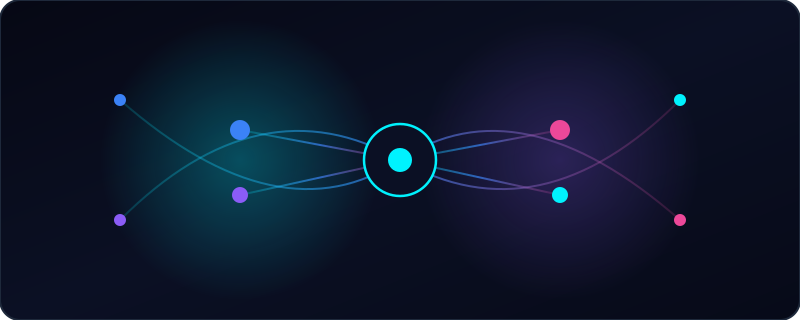
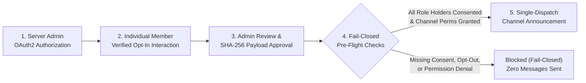

<!-- PROJECT SHIELDS -->

[![Deploy GitHub Pages][pages-shield]][pages-url]
[![Discord API][discord-shield]][discord-dev-url]
[![Status][status-shield]][live-docs-url]
[![Stargazers][stars-shield]][stars-url]
[![Issues][issues-shield]][issues-url]
[![MIT License][license-shield]][license-url]

<!-- PROJECT LOGO & HERO -->
 

  

  <h1 align="center">Global Reach</h1>

  

    <strong>Consent-Based Discord Campaign Management &amp; Community Outreach</strong>
     
    Coordinate administrator-approved announcements to explicitly opted-in notification roles—built on official Discord Bot OAuth2 permissions, cryptographic interaction verification, and strict privacy safeguards.
     
     
    <a href="https://punit-20.github.io/global-reach-public/docs/index.html"><strong>Explore the Docs »</strong></a>
     
     
    <a href="https://punit-20.github.io/global-reach-public/">Live Website</a>
    &middot;
    <a href="https://discord.com/oauth2/authorize?client_id=722756633499009045&permissions=274877910016&scope=bot%20applications.commands">Add to Discord (Preview)</a>
    &middot;
    <a href="https://github.com/punit-20/global-reach-public/issues/new?template=bug_report.yml">Report Bug</a>
    &middot;
    <a href="https://github.com/punit-20/global-reach-public/issues/new?template=feature_request.yml">Request Feature</a>
  

<!-- TABLE OF CONTENTS -->

  
<strong>Table of Contents</strong>

  <ol>
    <li>
      <a href="#about-the-project">About The Project</a>
      <ul>
        <li><a href="#why-global-reach">Why Global Reach?</a></li>
        <li><a href="#built-with--platform-standards">Built With &amp; Platform Standards</a></li>
      </ul>
    </li>
    <li><a href="#compliance--delivery-architecture">Compliance &amp; Delivery Architecture</a></li>
    <li><a href="#capability-status-matrix">Capability Status Matrix</a></li>
    <li>
      <a href="#getting-started">Getting Started</a>
      <ul>
        <li><a href="#prerequisites">Prerequisites</a></li>
        <li><a href="#installation--oauth2-authorization">Installation &amp; OAuth2 Authorization</a></li>
        <li><a href="#required-permissions-breakdown">Required Permissions Breakdown</a></li>
      </ul>
    </li>
    <li><a href="#documentation--legal-portal">Documentation &amp; Legal Portal</a></li>
    <li><a href="#roadmap">Roadmap</a></li>
    <li><a href="#contributing">Contributing</a></li>
    <li><a href="#security--privacy">Security &amp; Privacy</a></li>
    <li><a href="#license">License</a></li>
    <li><a href="#contact--maintainers">Contact &amp; Maintainers</a></li>
  </ol>

---

<!-- ABOUT THE PROJECT -->
## About The Project

  

 

**Global Reach** (Discord Application ID: `722756633499009045`) is a consent-based campaign management and community announcement utility designed for Discord server owners, community managers, and partner coordinators.

> [!IMPORTANT]
> **Pre-Verification Release Status:** Global Reach (`722756633499009045`) is currently in **pre-verification preview** and is not yet operating as an always-on public cloud service. Core compliance, cryptographic interaction verification, administrator campaign approval, channel permission evaluation, and user data-removal capabilities are implemented and verified offline, while hosted cloud webhook listeners, interactive in-Discord opt-in buttons, and `/campaign` slash commands are scheduled for rollout following Discord verification.

### Why Global Reach?

Growing Discord communities often need a structured, auditable way to publish community updates or partner announcements in designated `#announcements` channels without spamming `@everyone` or sending unsolicited Direct Messages (DMs). Global Reach solves this through four non-negotiable pillars:

* **100% Official Discord Bot Authentication:** Authenticates exclusively as a registered Discord Bot application via official OAuth2 permissions. Personal user-account automation ("self-botting") and unauthorized member harvesting are strictly prohibited.
* **Cryptographically Verified Individual Consent:** Never treats an administrator-assigned Discord role as proof of individual user consent. Every audience member must have an active, unrevoked consent record created from a verified user-initiated Discord interaction, and global opt-outs always take precedence.
* **Administrator Digest Approval & Single-Dispatch Locking:** Every campaign requires explicit approval from a verified server administrator bound to a SHA-256 digest of the campaign payload, locking state prior to dispatch so announcements cannot be altered or sent twice.
* **Channel-Only Delivery:** Publishes strictly to authorized server text or announcement channels after evaluating Discord's full channel permission hierarchy—never via unsolicited bulk DMs.

(<a href="#readme-top">back to top</a>)

### Built With & Platform Standards

* [![Discord Bot API v10][discord-tech-badge]][discord-dev-url]
* [![OAuth2 Least-Privilege][oauth-tech-badge]][live-install-url]
* [![Ed25519 Interaction Security][ed25519-tech-badge]][live-features-url]
* [![HTML5 & CSS3 Static Portal][html-tech-badge]][live-portal-url]
* [![GitHub Pages CI/CD][ghpages-tech-badge]][pages-url]

(<a href="#readme-top">back to top</a>)

---

<!-- ARCHITECTURE -->
## Compliance & Delivery Architecture

Global Reach enforces a fail-closed verification pipeline before any community announcement can be published to a Discord channel:

(<a href="#readme-top">back to top</a>)

---

<!-- CAPABILITY MATRIX -->
## Capability Status Matrix

| Capability | Current Status | Overview |
| :--- | :---: | :--- |
| **Official Bot Identity & OAuth2 Authorization** | ![Available][badge-available] | Server administrators can review requested permissions and authorize the application (`722756633499009045`) in test or target servers. |
| **Cryptographic Interaction & Consent Engine** | ![Implemented][badge-implemented] | Validates Ed25519 request signatures, blocks interaction replay, excludes bot accounts, and enforces persistent individual opt-in and opt-out rules. |
| **Channel Permission & Approval Engine** | ![Implemented][badge-implemented] | Evaluates `@everyone`, role, and member-specific channel overrides (`View Channels`, `Send Messages`, `Embed Links`) and binds administrator approvals to SHA-256 payload digests. |
| **Operator Privacy & Snapshot Cleanup Controls** | ![Implemented][badge-implemented] | Supports permanent user opt-out recording, multi-store user data removal, and cleanup of expired temporary audience snapshots. |
| **Hosted Cloud Webhook & Gateway Listener** | ![Planned][badge-planned] | Always-on cloud listener to receive live interactive events directly from Discord. |
| **In-Discord Opt-In Buttons & `/campaign` Commands** | ![Planned][badge-planned] | Self-service interactive buttons and slash commands inside Discord channels. |

(<a href="#readme-top">back to top</a>)

---

<!-- GETTING STARTED -->
## Getting Started

Follow these steps to authorize Global Reach in your test or target Discord server and verify channel permissions.

### Prerequisites

* A Discord account with **Manage Server** (`MANAGE_GUILD`) or **Administrator** permissions on the target Discord server.
* **Two-Factor Authentication (2FA)** enabled on your Discord account if your server enforces moderator 2FA.

### Installation & OAuth2 Authorization

1. **Launch the Official Discord OAuth2 Prompt:**
   Click the button below to open Discord's authorization flow for **Global Reach** (`722756633499009045`):

   [![Authorize Global Reach on Discord][invite-button-badge]][oauth-invite-url]

2. **Select Your Target Server:**
   Choose the server where you hold administrative permissions and review the requested scopes (`bot`, `applications.commands`).
3. **Verify Channel Permissions:**
   Ensure channel-specific permission overrides on your designated `#announcements` channel grant `View Channels`, `Send Messages`, and `Embed Links` to Global Reach.
4. **Read the Full Setup Guide:**
   See the [Installation & Permissions Guide][live-install-url] for complete details on Privileged Gateway Intents (`GUILD_MEMBERS`) and pre-verification scope.

### Required Permissions Breakdown

Global Reach requests permission integer **`274877910016`** with least-privilege channel access:

| Permission / Scope | Value / Bitflag | Purpose in Global Reach |
| :--- | :---: | :--- |
| `bot` & `applications.commands` | OAuth2 Scopes | Authorizes the official bot user and reserves slash-command registration scope for planned interactive commands. |
| **View Channels** | `1024` | Verifies target announcement channel visibility and evaluates channel permission overrides. |
| **Send Messages** | `2048` | Publishes administrator-approved announcements in designated server text or announcement channels. |
| **Embed Links** | `16384` | Renders structured campaign embeds with clear sponsor attribution. |
| **Read Message History** | `65536` | Included in the default OAuth2 install integer (`274877910016`) for standard channel compatibility; Global Reach **never** reads or stores user chat messages. |
| **Use Application Commands** | `2147483648` | Reserved for planned `/campaign` slash-command interactions. |

(<a href="#readme-top">back to top</a>)

---

<!-- DOCUMENTATION & LEGAL PORTAL -->
## Documentation & Legal Portal

All public documentation, architecture guides, and legal policies are hosted on GitHub Pages and maintained in this repository:

| Page | Repository File | Live URL | Description |
| :--- | :--- | :--- | :--- |
| **Landing Page** | [`index.html`](./index.html) | [View Live][live-portal-url] | Product overview, compliance workflow, and preview authorization link. |
| **Documentation Hub** | [`docs/index.html`](./docs/index.html) | [View Live][live-docs-url] | Central documentation portal for server administrators and reviewers. |
| **Installation Guide** | [`docs/installation.html`](./docs/installation.html) | [View Live][live-install-url] | Step-by-step OAuth2 setup, permission bitflags, and intent requirements. |
| **Features & Architecture** | [`docs/features.html`](./docs/features.html) | [View Live][live-features-url] | Core compliance capabilities, safety controls, and availability roadmap. |
| **FAQ** | [`docs/faq.html`](./docs/faq.html) | [View Live][live-faq-url] | Answers on consent verification, bot filtering, and data deletion scope. |
| **Support Center** | [`support.html`](./support.html) | [View Live][live-support-url] | Troubleshooting steps, bug reporting, and security disclosure links. |
| **Terms of Service** | [`terms.html`](./terms.html) | [View Live][live-terms-url] | Acceptable use rules, anti-spam policy, and campaign requirements. |
| **Privacy Policy** | [`privacy.html`](./privacy.html) | [View Live][live-privacy-url] | Processed Discord data categories, 7-day snapshot retention, and deletion boundaries. |

(<a href="#readme-top">back to top</a>)

---

<!-- ROADMAP -->
## Roadmap

- [x] Official Discord Bot API v10 authentication & identity verification
- [x] Ed25519 interaction signature verification & replay protection
- [x] Fail-closed individual opt-in consent registry & global opt-out precedence
- [x] SHA-256 digest-bound administrator campaign approval & single-dispatch locking
- [x] Full 6-step Discord channel permission hierarchy evaluation
- [x] Public documentation portal, Terms of Service, and Privacy Policy on GitHub Pages
- [ ] Complete Discord App Verification (`PUNIT DEVS` / App ID `722756633499009045`)
- [ ] Provision dedicated monitored private privacy intake channel prior to public launch
- [ ] Deploy hosted HTTPS interaction webhook server for live in-Discord opt-in/opt-out buttons
- [ ] Enable interactive `/campaign` slash commands for server administrators

See the [open issues][issues-url] for a full list of proposed features and known issues.

(<a href="#readme-top">back to top</a>)

---

<!-- CONTRIBUTING -->
## Contributing

Contributions to improve documentation clarity, accessibility, and community resources are welcome! Please read [`CONTRIBUTING.md`](./CONTRIBUTING.md) before submitting a pull request.

1. Fork the repository (`https://github.com/punit-20/global-reach-public/fork`)
2. Create your feature branch (`git checkout -b docs/improve-guide`)
3. Commit your changes (`git commit -m 'Improve installation permission table'`)
4. Push to the branch (`git push origin docs/improve-guide`)
5. Open a Pull Request

> [!CAUTION]
> **Strict Privacy & Credential Rule:** Never commit or paste Discord tokens, configuration secrets, HTTP `Authorization` headers, session cookies, or personal Discord User/Server IDs in issues, discussions, or pull requests.

(<a href="#readme-top">back to top</a>)

---

<!-- SECURITY & PRIVACY -->
## Security & Privacy

* **Private Vulnerability Disclosure:** Do **not** report software security vulnerabilities or credential leaks in public GitHub Issues. Please review [`SECURITY.md`](./SECURITY.md) and submit a confidential report via **[GitHub Private Security Advisories][security-advisory-url]**.
* **Privacy & Data Deletion Disclosures:** Review our **[Privacy Policy (`privacy.html`)](./privacy.html)** for transparent disclosures on Discord data handling, temporary audience snapshot retention, user data deletion boundaries, and pre-launch privacy intake status.

(<a href="#readme-top">back to top</a>)

---

<!-- LICENSE -->
## License

Distributed under the **MIT License**. See [`LICENSE`](./LICENSE) for full license text.

(<a href="#readme-top">back to top</a>)

---

<!-- CONTACT -->
## Contact & Maintainers

* **Developer Team:** **PUNIT DEVS** (`Global Reach Team` / [`@punit-20`](https://github.com/punit-20))
* **Public Website:** [https://punit-20.github.io/global-reach-public/][live-portal-url]
* **Project Repository:** [https://github.com/punit-20/global-reach-public][repo-url]
* **Community Discussions:** [GitHub Discussions][discussions-url]
* **Bug Reports & Feature Requests:** [GitHub Issues][issues-url]

(<a href="#readme-top">back to top</a>)

<!-- MARKDOWN LINKS & IMAGES -->
[pages-shield]: https://img.shields.io/github/actions/workflow/status/punit-20/global-reach-public/pages.yml?branch=main&style=for-the-badge&logo=githubactions&logoColor=white&label=GitHub%20Pages
[pages-url]: https://github.com/punit-20/global-reach-public/actions/workflows/pages.yml
[discord-shield]: https://img.shields.io/badge/Discord_API-v10_Compliant-5865F2?style=for-the-badge&logo=discord&logoColor=white
[discord-dev-url]: https://discord.com/developers/docs/intro
[status-shield]: https://img.shields.io/badge/Status-Pre--Verification_Preview-F59E0B?style=for-the-badge
[stars-shield]: https://img.shields.io/github/stars/punit-20/global-reach-public.svg?style=for-the-badge
[stars-url]: https://github.com/punit-20/global-reach-public/stargazers
[issues-shield]: https://img.shields.io/github/issues/punit-20/global-reach-public.svg?style=for-the-badge
[issues-url]: https://github.com/punit-20/global-reach-public/issues
[license-shield]: https://img.shields.io/github/license/punit-20/global-reach-public.svg?style=for-the-badge
[license-url]: https://github.com/punit-20/global-reach-public/blob/main/LICENSE

[discord-tech-badge]: https://img.shields.io/badge/Discord_Bot_API-v10-5865F2?style=flat-square&logo=discord&logoColor=white
[oauth-tech-badge]: https://img.shields.io/badge/OAuth2-Least_Privilege-00D4FF?style=flat-square&logo=auth0&logoColor=white
[ed25519-tech-badge]: https://img.shields.io/badge/Security-Ed25519_Verified-10B981?style=flat-square&logo=letsencrypt&logoColor=white
[html-tech-badge]: https://img.shields.io/badge/Portal-HTML5_%26_CSS3-E34F26?style=flat-square&logo=html5&logoColor=white
[ghpages-tech-badge]: https://img.shields.io/badge/Deployed_on-GitHub_Pages-222222?style=flat-square&logo=githubpages&logoColor=white

[badge-available]: https://img.shields.io/badge/Available-Preview-10B981?style=flat-square
[badge-implemented]: https://img.shields.io/badge/Implemented-Core_Engine-3B82F6?style=flat-square
[badge-planned]: https://img.shields.io/badge/Planned-Post--Verification-F59E0B?style=flat-square
[invite-button-badge]: https://img.shields.io/badge/Add_Global_Reach_to_Discord-Authorize_via_OAuth2-5865F2?style=for-the-badge&logo=discord&logoColor=white

[repo-url]: https://github.com/punit-20/global-reach-public
[discussions-url]: https://github.com/punit-20/global-reach-public/discussions
[security-advisory-url]: https://github.com/punit-20/global-reach-public/security/advisories/new
[oauth-invite-url]: https://discord.com/oauth2/authorize?client_id=722756633499009045&permissions=274877910016&scope=bot%20applications.commands
[live-portal-url]: https://punit-20.github.io/global-reach-public/
[live-docs-url]: https://punit-20.github.io/global-reach-public/docs/index.html
[live-install-url]: https://punit-20.github.io/global-reach-public/docs/installation.html
[live-features-url]: https://punit-20.github.io/global-reach-public/docs/features.html
[live-faq-url]: https://punit-20.github.io/global-reach-public/docs/faq.html
[live-support-url]: https://punit-20.github.io/global-reach-public/support.html
[live-terms-url]: https://punit-20.github.io/global-reach-public/terms.html
[live-privacy-url]: https://punit-20.github.io/global-reach-public/privacy.html
